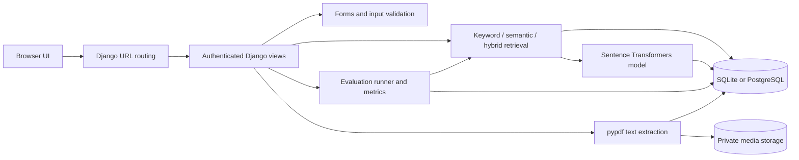
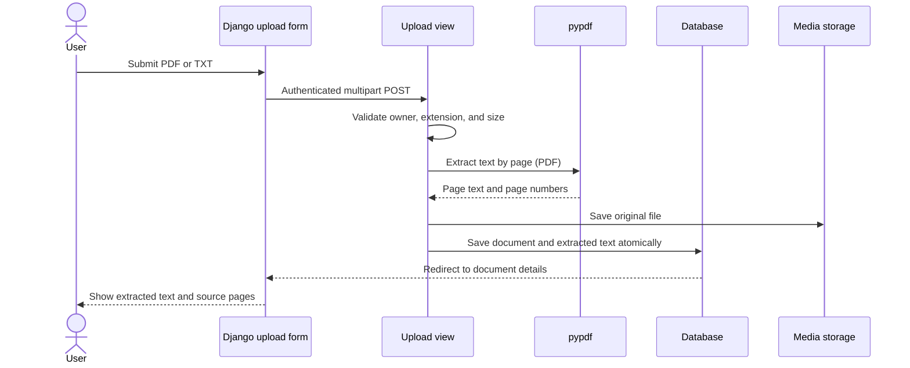
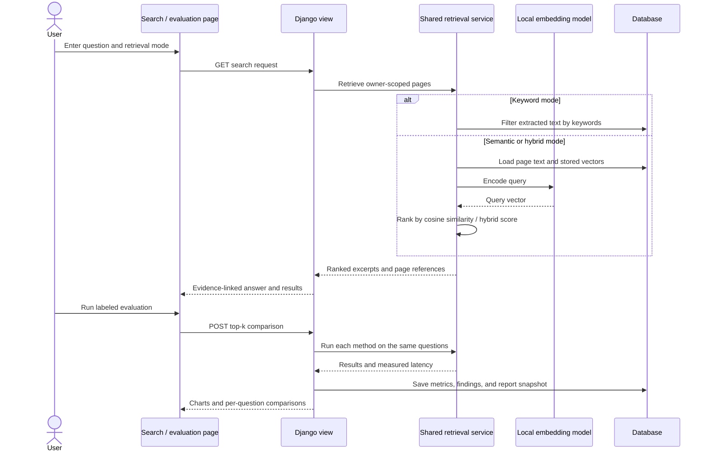

# Architecture diagrams

## Component architecture

The browser sends requests to Django. Views require a signed-in user for document, search, and evaluation operations. Django ORM stores accounts, document metadata, extracted page text, embeddings, labeled questions, and saved evaluation reports. Original uploads are stored under the configured media storage. PDF text is extracted with pypdf; semantic embeddings are generated locally with Sentence Transformers.

## Upload and extraction sequence

## Retrieval and evaluation sequence

## Retrieval score definitions

- **Keyword:** query tokens are matched against extracted page text. The score combines query-term coverage and match frequency.
- **Semantic:** normalized query and page-chunk embeddings are compared by cosine similarity. Since vectors are normalized, the implementation uses their dot product.
- **Hybrid:** `0.5 × keyword score + 0.5 × max(cosine similarity, 0)`.

The current exact vector scan is intended for a small research collection. A larger deployment should replace it with an approximate-nearest-neighbor index.
